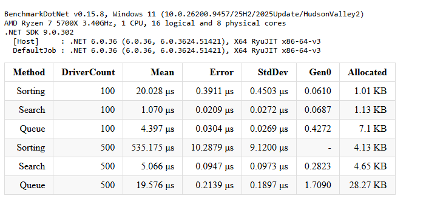

# DriverMatching

Программа для поиска 5 ближайших водителей к заказу.

Написана на C# 10, .NET 6.

В программе есть карта, на которую можно добавлять водителей и менять их координаты. У каждого водителя свой ID.

Реализовано 3 алгоритма:

1. Sorting — сортировка пузырьком.
2. Search — поиск 5 ближайших водителей по очереди.
3. Queue — поиск через очередь с приоритетом.

Для проверки алгоритмов использовал NUnit. Все 3 теста прошли успешно.

Скорость алгоритмов проверил через BenchmarkDotNet на 100 и 500 водителях.

Результаты на 500 водителях:

- Sorting — 535.175 мкс
- Search — 5.066 мкс
- Queue — 19.576 мкс

Самым быстрым оказался второй алгоритм Search, а самым медленным Sorting.

Для запуска нужно открыть проект в Visual Studio 2022 и нажать Ctrl + F5. Для проверки скорости нужно запустить DriverMatching.Benchmarks в режиме Release.